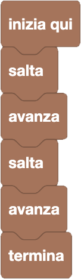

import { toolboxEn as toolbox } from "./toolbox.en";
import initialBlocks from "./initial-blocks.json";
import customBlocks from "./s0.en.blocks";
import testcases from "./testcases.py";
import { VisualizerEn as Visualizer } from "./visualizer";
import { Hint } from "~/utils/hint";

Carol has entered an obstacle course race!
The course consists of a sequence of rocks, either flat or tall: Carol can stand only on flat rocks, while tall rocks are obstacles.
If she lands with a jump on a tall rock, she falls and loses the race. If instead she tries to move forward, she cannot do so and stays where she is.
The goal is to reach the final flag.
You have these blocks:

- `move forward`: move to the next rock **if possible** (stay still if there is an obstacle ahead).
- `jump`: jump over the next rock and land on the rock after it.
- `finish`: finish the race.

In the block editor on the lower right, write a program that lets Carol complete the race!

You can find all the blocks you need in the _“Execution”_ section and drag them into the window. Attach them below the _“Start here”_ block to build your program.
To test your solution, press the green _“Check solution”_ button with the paper airplane: you will see whether it is correct, and you can check the program’s behavior using the
blue _“Run/pause”_, _“Run one block”_, and _“Run from start”_ buttons.

If you need help, try reading this hint:

<Hint>
  Look at the rabbit’s position: where should you start?
  Do you need to move forward or jump? Once you decide which operation to use,
  find it in the _“Execution”_ section and drag it below the _“Start here”_ block.
  See where the rabbit ends up (you can run your solution!),
  then continue in the same way to determine the other actions.
</Hint>

<Blockly
  toolbox={toolbox}
  customBlocks={customBlocks}
  initialBlocks={initialBlocks}
  testcases={testcases}
  visualizer={Visualizer}
/>

> One possible correct program is:
>
> 
>
> According to this program, the character jumps over the obstacle ahead,
> moves forward to the next rock, jumps over the second obstacle, and moves forward
> once more to reach the flag.

Before moving to the next question, make sure you have solved this one!

If you solved it, you should see a green _“✓”_ in the upper left, above the level preview and after the **Level** label.
