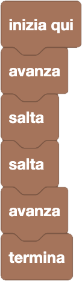

import { toolboxEn as toolbox } from "./toolbox.en";
import initialBlocks from "./initial-blocks.json";
import customBlocks from "./s1.en.blocks";
import testcases from "./testcases.py";
import { VisualizerEn as Visualizer } from "./visualizer";
import { Hint } from "~/utils/hint";

We are back at Carol’s obstacle race, and you have the same blocks as before:

- `move forward`: move to the next rock **if possible** (stay still if there is an obstacle ahead).
- `jump`: jump over the next rock and land on the rock after it.
- `finish`: finish the race.

This time, Carol must complete **two different levels with one program!**

When you test your solution by pressing _“Check solution”_, you will see in one go which levels this question has solved correctly.
The levels are listed in the upper left after the **Level** label. You will see a green _“✓”_ for each level you pass and a red _“✗”_ for each level you do not pass.
Clicking one of these symbols lets you choose the level to test with _“Run/pause”_.

Warning: this question is quite difficult. If you need help, try reading these hints:

<Hint label="hint 1">
  Look closely at both levels. How many times will you have to jump?
</Hint>

<Hint label="hint 2">
  When you perform the _“move forward”_ action, the character stays still if an obstacle is ahead. How can you use that?
</Hint>

<Hint label="hint 3">
  Before each jump, how many times must you move forward to reach the obstacle in both levels?
</Hint>

<Blockly
  toolbox={toolbox}
  customBlocks={customBlocks}
  initialBlocks={initialBlocks}
  testcases={testcases}
  visualizer={Visualizer}
/>

> One possible correct program is:
>
> 
>
> To set up a program, we need to examine both levels.
> First, to determine how many times we need to jump:
> - to complete the first level we need to jump at least twice;
> - to complete the second level it is enough to jump at least once.
> To complete both with the same actions, we therefore need to jump at least twice.
>
> Before the first jump:
> - we do not need to move forward in the first level;
> - we need to move forward at least once in the second level.
> To complete both with the same actions, we therefore need to move forward at least once.
>
> No movement is needed before the second jump, which is only necessary in the first level.
>
> Because the course is short, it is useful to use as few actions as possible.
> We will therefore make exactly two jumps, moving forward once before the first jump.
> With these actions, we do not reach the flag in the first level:
> we therefore need one final move-forward action.

Before moving to the next question, make sure you have solved **all levels** of this one!

If you solved it, you should see two green _“✓”_ symbols in the upper left after the **Level** label.
