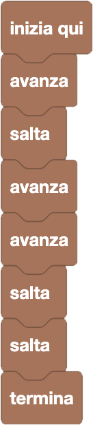

import { toolboxEn as toolbox } from "./toolbox.en";
import initialBlocks from "./initial-blocks.json";
import customBlocks from "./s2.en.blocks";
import testcases from "./testcases.py";
import { VisualizerEn as Visualizer } from "./visualizer";
import { Hint } from "~/utils/hint";

Once again, Carol is taking part in the obstacle race, and you have the same blocks:

- `move forward`: move to the next rock **if possible** (stay still if there is an obstacle ahead).
- `jump`: jump over the next rock and land on the rock after it.
- `finish`: finish the race.

As before, Carol can use only one program; this time, however, it must complete **four different levels**.

Use the same reasoning as in the previous question to show that you understand how to solve several levels together.

If you need help, try reading these hints:

<Hint label="hint 1">
  Look closely at all levels. How many times will you need to jump?
</Hint>

<Hint label="hint 2">
  When you perform the _“move forward”_ action, the character stays still if an obstacle is ahead. How can you use this?
</Hint>

<Hint label="hint 3">
  Look at the levels one at a time: before each jump, how many times must you move forward to reach the obstacle?
</Hint>

<Blockly
  toolbox={toolbox}
  customBlocks={customBlocks}
  initialBlocks={initialBlocks}
  testcases={testcases}
  visualizer={Visualizer}
/>

> One possible correct program is:
>
> 
>
> To work out the program, we need to look at all the levels.
> - To complete the first level, it is enough to move forward far enough.
> - To complete the second level, we need to jump three times; this also completes the first level.
> - To complete the third level, we need to move forward at least once before the first two jumps. This has no effect in the second level, so we now complete the first three levels.
> - To complete the fourth level, we need to move forward a second time before the second jump. This has no effect in the second or third level, so we complete all levels.

Before moving to the next question, make sure you have solved **all levels** of this one!

If you solved it, you should see four green _“✓”_ symbols in the upper left after the **Level** label.
