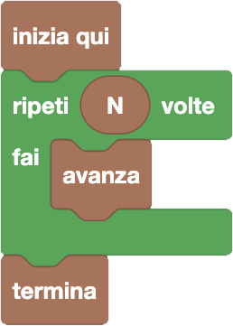

import { toolboxEn as toolbox } from "./toolbox.en";
import initialBlocks from "./initial-blocks.json";
import customBlocks from "./s3.en.blocks";
import testcases from "./testcases.py";
import { VisualizerEn as Visualizer } from "./visualizer";
import { Hint } from "~/utils/hint";

We are still at Carol’s obstacle race, although this time **there are no obstacles!**
In the _“Execution”_ section, you have the same blocks as before for solving four levels, **plus one new block:**

- `N`: the number of rocks that initially separate you from the flag **(new!)**.
- `move forward`: move to the next rock if possible (stay still if there is an obstacle ahead).
- `jump`: jump over the next rock and land on the rock after it.
- `finish`: finish the race.

Notice that the new `N` block has a rounded shape, unlike the others: that is because it is not an action block (a block that _does something_), but a block that _produces a value_
(in this case, the number of rocks between you and the flag). It cannot be attached below _“Start here”_; instead, it must be inserted into another action block
(a rectangular block) that contains a similarly rounded space.

You will also notice that a new _“Loops”_ section has appeared! To solve the level, you need to use your first _“repeat N times”_ loop.
This block lets you specify how many times to repeat some operations by placing a value block in place of the standard number of repetitions (10).
You can also specify which action blocks to repeat by placing them in the rectangular space in the middle of the block.

If you need help, try reading this hint:

<Hint>
  To solve all levels, you will need a loop.

  Which operation should you put inside the loop?

  How many times should you repeat it?
</Hint>

<Blockly
  toolbox={toolbox}
  customBlocks={customBlocks}
  initialBlocks={initialBlocks}
  testcases={testcases}
  visualizer={Visualizer}
/>

> One possible correct program is:
>
> 
>
> According to this program, the character moves forward $N$ times, passing the obstacle exactly.

Before moving to the next question, make sure you have solved **all levels** of this one!

If you solved it, you should see four green _“✓”_ symbols in the upper left after the **Level** label.