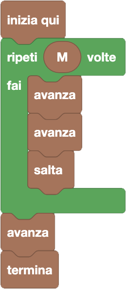

import { toolboxEn as toolbox } from "./toolbox.en";
import initialBlocks from "./initial-blocks.json";
import customBlocks from "./s4.en.blocks";
import testcases from "./testcases.py";
import { VisualizerEn as Visualizer } from "./visualizer";
import { Hint } from "~/utils/hint";

We are still at Carol’s obstacle race, and obstacles have appeared again.
You have the same blocks as before for solving four levels, **plus one new block:**

- `N`: the number of rocks that initially separate you from the flag.
- `M`: the number of obstacles that initially separate you from the flag **(new!)**.
- `move forward`: move to the next rock if possible (stay still if there is an obstacle ahead).
- `jump`: jump over the next rock and land on the rock after it.
- `finish`: finish the race.

You will need to use loops again. If you need help, try reading this hint:

<Hint>
  Look closely at all levels. How many times must you jump?

  Before each jump, how many times must you move forward at least once to reach the obstacle?

  After all jumps, how many times must you move forward at least once to reach the flag?
</Hint>

<Blockly
  toolbox={toolbox}
  customBlocks={customBlocks}
  initialBlocks={initialBlocks}
  testcases={testcases}
  visualizer={Visualizer}
/>

> One possible correct program is:
>
> 
>
> Since there are $M$ obstacles, we need to jump $M$ times.
> To complete the third level, we need to move forward at least once before each jump.
> To complete the last level, we need to move forward at least twice before each jump and once more after the jumps.
