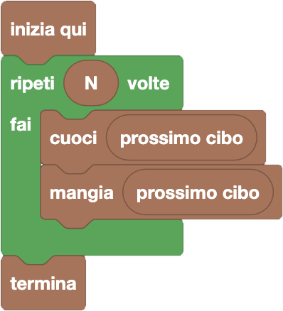

import { toolboxEn as toolbox } from "./toolbox.en";
import initialBlocks from "./initial-blocks.json";
import customBlocks from "./s1.en.blocks";
import testcases from "./testcases.py";
import { VisualizerEn as Visualizer } from "./visualizer";
import { Hint } from "~/utils/hint";

**Tip-Tap** has to prepare lunch and has lined up several foods that he wants to eat one by one, **after cooking them.**
You have these blocks:

- `N`: the total number of lined-up foods.
- `next food`: the next food in line to eat.
- `cook` $x$: cook food $x$.
- `eat` $x$: eat food $x$.
- `finish`: stop eating and leave lunch.

Write a program that lets Tip-Tap have lunch the way he likes best!

You just need to use the same types of blocks seen in the previous lesson: instruction blocks (rectangular) and value blocks (rounded), which you can find in the _“Execution”_ and _“Loops”_ sections.
Note that some _“Execution”_ blocks this time contain an empty slot where you can insert another value block, just like when you insert a value block into the “repeat N times” loop to specify how many times to repeat.

Also note that **not all values are the same:** the `N` block produces a numerical value, while the `next food` block produces a food as a value. And numbers cannot be cooked or eaten...

<Hint>
  You must repeatedly cook and then eat all `N` foods in line. How can you translate this sentence into a program?
</Hint>

<Blockly
  toolbox={toolbox}
  customBlocks={customBlocks}
  initialBlocks={initialBlocks}
  testcases={testcases}
  visualizer={Visualizer}
/>

> One possible correct program is:
>
> 
>
> According to this program, for each of the $N$ foods that Tip-Tap wants to eat, he cooks it and then eats it.

Before moving to the next question, make sure you have solved **all levels** of this one!

If you solved it, you should see four green _“✓”_ marks in the top left next to **Level**.
