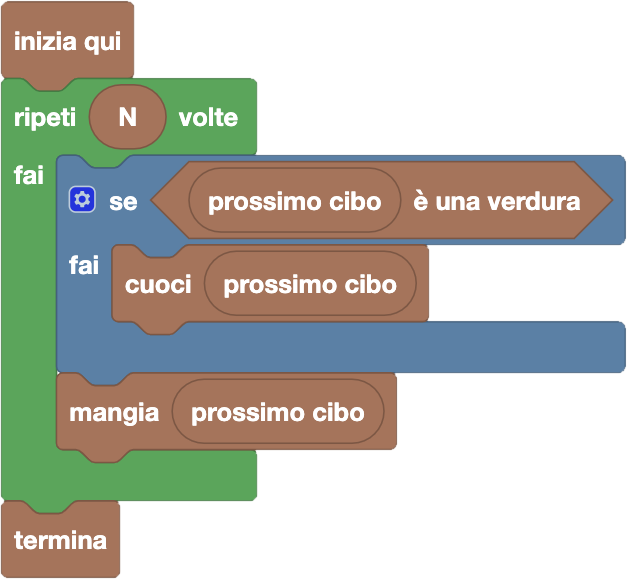

import { toolboxEn as toolbox } from "./toolbox.en";
import initialBlocks from "./initial-blocks.json";
import customBlocks from "./s2.en.blocks";
import testcases from "./testcases.py";
import { VisualizerEn as Visualizer } from "./visualizer";
import { Hint } from "~/utils/hint";

**Bunny** is also having lunch now and has lined up some foods. Like Tip-Tap, he cooks vegetables; however, **he doesn't like cooked fruit.**
You have the same blocks as before, plus one to check whether a food is a fruit or a vegetable:

- `N`: the total number of lined-up foods.
- `next food`: the next food in line to eat.
- $x$ `is a vegetable`: true if food $x$ is a vegetable **(new!)**.
- `cook` $x$: cook food $x$.
- `eat` $x$: eat food $x$.
- `finish`: stop eating and leave lunch.

Write a program that lets Bunny have lunch the way he likes best, cooking only vegetables!

Note that the block checking whether a food is a vegetable (still in the _“Execution”_ section) has a different shape than usual, an elongated hexagon.
In block programming, this is the shape of _truth blocks_, which produce a true/false value! To recap the types of blocks seen so far:

- **instruction blocks (rectangular)**, used to perform an action;
- **value blocks (rounded)**, used to produce a value (numerical or otherwise);
- **truth blocks (hexagonal)**, used to produce a boolean truth value (true or false).

All blocks can contain one or more slots of any shape (rectangular, rounded, or hexagonal). For example, the `is a vegetable`, `cook`, and `eat` blocks have a single rounded slot. In contrast, the “repeat N times” block has both a rounded slot (to specify the number of repetitions) and a rectangular slot (to specify what to repeat).

You can also see that a new section has appeared: _“Logic”_! For now, in this section you only find the “if ... do” block. This is an instruction block called a _conditional_, which has a hexagonal slot (for a condition) and a rectangular slot (for actions). The block will perform the indicated actions **only if** the condition evaluates to true.

<Hint>
  You must repeatedly eat all `N` foods in line, cooking them first only if they are vegetables. How can you translate this sentence into a program?
</Hint>

<Blockly
  toolbox={toolbox}
  customBlocks={customBlocks}
  initialBlocks={initialBlocks}
  testcases={testcases}
  visualizer={Visualizer}
/>

> One possible correct program is:
>
> 
>
> According to this program, for each of the $N$ foods that Bunny wants to eat, he checks whether the next food is a vegetable, and if so, cooks it. In either case, he then eats the next food (either cooked vegetable or raw fruit).

Before moving to the next question, make sure you have solved **all levels** of this one!
