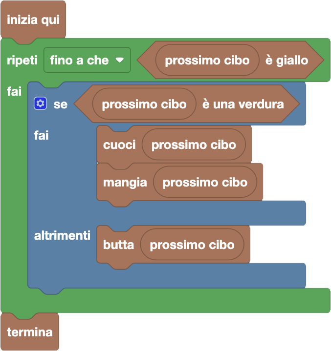

import { toolboxEn as toolbox } from "./toolbox.en";
import initialBlocks from "./initial-blocks.json";
import customBlocks from "./s3.en.blocks";
import testcases from "./testcases.py";
import { VisualizerEn as Visualizer } from "./visualizer";
import { Hint } from "~/utils/hint";

Now **Allie** is also having lunch and has lined up some foods. Unlike Bunny, Allie eats **cooked vegetables** but **doesn't like fruit at all**, and throws it away!
Furthermore, she is **allergic to yellow foods**, so as soon as a yellow food arrives, she stops having lunch and leaves.
You have these blocks:

- `prossimo cibo`: the next food in line to eat.
- $x$ `is a vegetable`: true if food $x$ is a vegetable.
- $x$ `is yellow`: true if food $x$ is yellow **(new!)**.
- `cook` $x$: cook food $x$.
- `eat` $x$: eat food $x$.
- `throw away` $x$: throw away food $x$ **(new!)**.
- `finish`: stop eating and leave lunch.

Write a program that lets Allie have lunch the way she likes best, without wasting time cooking things before throwing them away!

This time in the _“Logic”_ section there is an additional instruction block: “if ... do ... else”. This is also called a _conditional_ and works like “if ... do”, but has an extra rectangular slot to specify actions to execute when the inserted condition (hexagonal) is false.

Additionally, in the _“Loops”_ section there is an extra instruction block: “repeat while/until”, which has a hexagonal slot (for a condition) and a rectangular slot (for actions).
In the “repeat while” form, it repeats actions multiple times while the condition is true, stopping as soon as the condition becomes false.
After dragging it, you can click on the dropdown arrow after “while” to turn it into “repeat until”: in this case, it repeats actions while the condition is false, stopping as soon as it becomes true.

<Hint>
  You must repeatedly process the foods in line, cooking and eating them if they are vegetables, and throwing them away if they are fruit, stopping as soon as a yellow food arrives. How can you translate this sentence into a program?
</Hint>

<Blockly
  toolbox={toolbox}
  customBlocks={customBlocks}
  initialBlocks={initialBlocks}
  testcases={testcases}
  visualizer={Visualizer}
/>

> One possible correct program is:
>
> 
>
> According to this program, Allie keeps eating foods until she sees the color yellow.
> For each food she encounters up to that point, she checks whether the next food is a vegetable; if so, she cooks it and eats it. Otherwise it is fruit, and so she throws it away.

Before moving to the next question, make sure you have solved **all levels** of this one!
