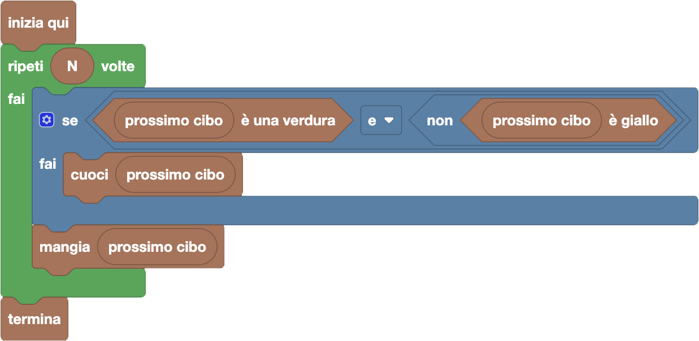

import { toolboxEn as toolbox } from "./toolbox.en";
import initialBlocks from "./initial-blocks.json";
import customBlocks from "./s4.en.blocks";
import testcases from "./testcases.py";
import { VisualizerEn as Visualizer } from "./visualizer";
import { Hint } from "~/utils/hint";

**Carol** is now also having lunch and has lined up some foods. Like Bunny, she eats everything and prefers eating raw fruit.
However, she doesn't cook all vegetables: **she only cooks vegetables that are not yellow!**
You have the same blocks as before:

- `N`: the total number of lined-up foods.
- `next food`: the next food in line to eat.
- $x$ `is a vegetable`: true if food $x$ is a vegetable.
- $x$ `is yellow`: true if food $x$ is yellow.
- `cook` $x$: cook food $x$.
- `eat` $x$: eat food $x$.
- `throw away` $x$: throw away food $x$.
- `finish`: stop eating and leave lunch.

Write a program that lets Carol have lunch the way she likes best!

Now in the _“Logic”_ section there are two new truth blocks (hexagonal) with hexagonal slots: “and/or” (which is initially “and” but can be changed to “or”) and “not”.
These blocks are called _logical operations_ on the truth values inserted into the slots (which we call _arguments_), and produce:

- for the “not” block: the opposite of the single argument (producing false if the argument is true, and true if the argument is false);
- for the “and” block: true only if both arguments are true, and false in all other cases;
- for the “or” block: false only if both arguments are false, and true in all other cases.

<Hint>
  Carol’s behavior differs from Allie’s but is very similar to Bunny’s, changing only the condition under which she cooks foods: she cooks them if they are vegetables and not yellow. How can you translate this condition into blocks?
</Hint>

<Blockly
  toolbox={toolbox}
  customBlocks={customBlocks}
  initialBlocks={initialBlocks}
  testcases={testcases}
  visualizer={Visualizer}
/>

> One possible correct program is:
>
> 
>
> According to this program, for each of the $N$ foods that Carol wants to eat, she checks whether the next food is a vegetable *and* is not yellow, and if so, cooks it before eating it. Then she eats the next food (vegetable or fruit, yellow or not), which will be to her liking.
