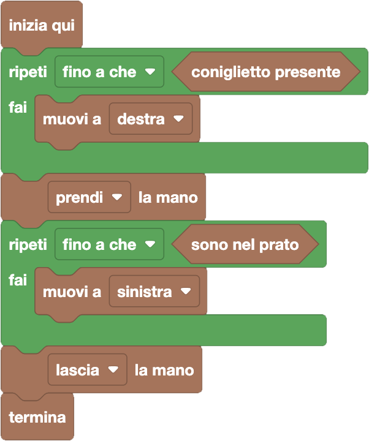

import { toolboxEn as toolbox } from "./toolbox.en";
import initialBlocks from "./initial-blocks.json";
import customBlocks from "./s1.en.blocks";
import testcases from "./testcases.py";
import { VisualizerEn as Visualizer } from "./visualizer";
import { Hint } from "~/utils/hint";

At Fibonacci Farm, it’s recess time for the little bunnies to play together in the meadow!
However, one of them stayed behind in the farmhouse, and Allie has been tasked with retrieving it.
Fibonacci Farm consists of several rooms arranged in a row and separated by doors, like a long hallway.
At the beginning, Allie is in the meadow, which is to the left of the rooms.
You have these blocks:

- `N`: the number of rooms in the farm.
- `in the meadow`: true if Allie is in the meadow.
- `move right/left`: move into the room (or meadow) to the right/left of the current room (or meadow).
- `bunny present`: true if a bunny is present in the current room.
- `hold/let go of hand`: hold/let go of the bunny's hand in the current room.
- `finish`: start recess.

While Allie holds the bunny's hand, the bunny will follow all of Allie’s movements.
Help Allie retrieve the missing bunny and bring it to the meadow before starting recess!

You only need to use the same types of blocks seen in the previous lesson:

- **instruction blocks (rectangular)**, used to perform an action (including loops and conditionals);
- **value blocks (rounded)**, used to produce a value (numerical or otherwise);
- **truth blocks (hexagonal)**, used to produce a boolean value (true or false).

Note that some _“Execution”_ blocks this time can be configured just like the “and/or” and “repeat while/until” blocks:
they have options (right/left, hold/let go) that can be changed by clicking on the dropdown arrow.

<Hint>
  How can you make a first loop to reach the bunny? How can you make a second loop to exit into the meadow?
</Hint>

<Blockly
  toolbox={toolbox}
  customBlocks={customBlocks}
  initialBlocks={initialBlocks}
  testcases={testcases}
  visualizer={Visualizer}
/>

> One possible correct program is:
>
> 
>
> First, Allie must reach the bunny in the farm.
> She keeps moving right, repeating until the bunny is present in the room she is in, and then holds its hand.
>
> At this point, Allie must exit the farm.
> She keeps moving left (bringing the bunny along), repeating until she reaches the meadow.
> At this point she can let go of the bunny's hand and start recess!

Before moving to the next question, make sure you have solved **all levels** of this one!
