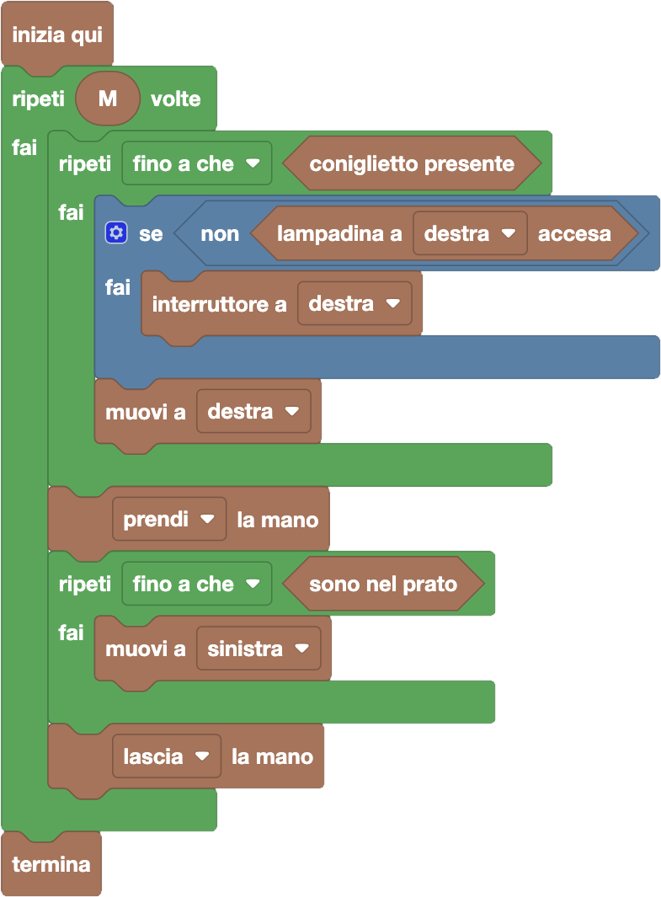

import { toolboxEn as toolbox } from "./toolbox.en";
import initialBlocks from "./initial-blocks.json";
import customBlocks from "./s2.en.blocks";
import testcases from "./testcases.py";
import { VisualizerEn as Visualizer } from "./visualizer";
import { Hint } from "~/utils/hint";

It’s recess time again. Today, however, several bunnies remained in the farm!
Not only that: some lights in the farm may be off. This is a problem because Allie is afraid of the dark, so she won't enter a room without turning on its light first. In each room there are two switches to control the lightbulbs of the rooms to the left and right. The light of the first room can also be controlled from outside.
When a switch is pressed, it turns the light on if it is off, and off if it is on.

Allie starts again from the meadow and must retrieve all bunnies. You have these blocks:

- `N`: the number of rooms in the farm.
- `M`: the number of bunnies to retrieve **(new!)**.
- `in the meadow`: true if Allie is in the meadow.
- `move right/left`: move into the room (or meadow) to the right/left of the current room (or meadow).
- `bunny present`: true if a bunny is present in the current room.
- `hold/let go of hand`: hold/let go of the bunny's hand in the current room.
- `lightbulb to the right/left is on`: true if the lightbulb in the room to the right/left is on **(new!)**.
- `switch right/left`: press the switch controlling the room to the right/left **(new!)**.
- `finish`: start recess.

Help Allie retrieve all bunnies and bring them outside to the meadow!

<Hint>
  You can repeat the procedure from the previous question $M$ times (once for each bunny), taking care to turn on the lights whenever you encounter a dark room!
</Hint>

<Blockly
  toolbox={toolbox}
  customBlocks={customBlocks}
  initialBlocks={initialBlocks}
  testcases={testcases}
  visualizer={Visualizer}
/>

> One possible correct program is:
>
> 
>
> In this program, Allie performs $M$ rescue missions, once for each bunny.
> Each time, before moving right, if the room to the right is dark, she presses the switch to turn on its light.
> Once she finds a bunny, she holds its hand and walks back left all the way to the meadow, letting go of its hand outside.
