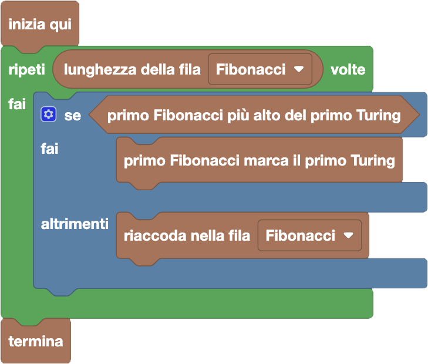

import { toolboxEn as toolbox } from "./toolbox.en";
import initialBlocks from "./initial-blocks.json";
import customBlocks from "./s3.en.blocks";
import testcases from "./testcases.py";
import { VisualizerEn as Visualizer } from "./visualizer";
import { Hint } from "~/utils/hint";

The animals of Turing Farm have challenged Fibonacci Farm to a basketball match!
Bunny now needs to select a team from the Fibonacci rabbits to compete against the rival farm.
To give them the best chance of victory, he wants to assign each Turing player a Fibonacci rabbit that is **taller than him**, so that they can easily defend against them.

Bunny has lined up the rabbits from both farms in ascending order of height.
He can now use these operations:

- `length of line Fibonacci/Turing`: number of rabbits in the Fibonacci/Turing line.
- `requeue in line Fibonacci/Turing`: send the next rabbit in the Fibonacci/Turing line to the back of the line.
- `first Fibonacci taller than first Turing`: true if both lines have rabbits and the first rabbit in the Fibonacci line is taller than the first rabbit in the Turing line.
- `first Fibonacci marks first Turing`: put the first rabbit of the Fibonacci line on the team to mark the first rabbit of the Turing line. **Note:** this removes both rabbits from their respective lines.
- `finish`: start the match with the selected teams.

Help Bunny form the teams, but beware: you can use **only one repeat N loop!**

<Hint>
  In what case can the first Fibonacci rabbit mark the first Turing rabbit?
  And if he cannot, what should you do?
</Hint>

<Blockly
  toolbox={toolbox}
  customBlocks={customBlocks}
  initialBlocks={initialBlocks}
  testcases={testcases}
  visualizer={Visualizer}
/>

> One possible correct program is:
>
> 
>
> This program considers all Fibonacci rabbits one by one.
> If the first rabbit in the Fibonacci line is tall enough, he is assigned as a defender.
> Otherwise he is dismissed to the back of the line. We don't need to consider him again: if he was too short for this opponent, he is also too short for all subsequent opponents!
