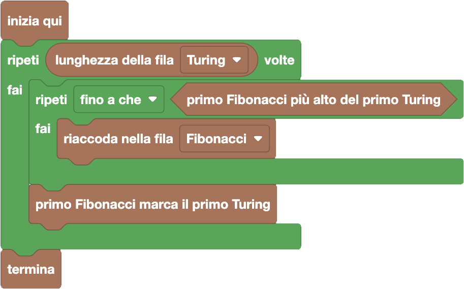

import { toolboxEn as toolbox } from "./toolbox.en";
import initialBlocks from "./initial-blocks.json";
import customBlocks from "./s4.en.blocks";
import testcases from "./testcases.py";
import { VisualizerEn as Visualizer } from "./visualizer";
import { Hint } from "~/utils/hint";

Turing Farm has sent another team for a rematch!
Bunny would like to proceed as before, but this time he couldn't get his fellow Fibonacci rabbits in order of height.
Furthermore, the Turing team lined up in **descending** order of height.
The operations available are the same as before:

- `length of line Fibonacci/Turing`: number of rabbits in the Fibonacci/Turing line.
- `requeue in line Fibonacci/Turing`: send the next rabbit in the Fibonacci/Turing line to the back of the line.
- `first Fibonacci taller than first Turing`: true if both lines have rabbits and the first rabbit in the Fibonacci line is taller than the first rabbit in the Turing line.
- `first Fibonacci marks first Turing`: put the first rabbit of the Fibonacci line on the team to mark the first rabbit of the Turing line. **Note:** this removes both rabbits from their respective lines.
- `finish`: start the match with the selected teams.

Help Bunny form the teams for the match, assigning each member of the Turing team a Fibonacci rabbit that is taller than him.
Beware: this time you will need to use **two nested loops!**

<Hint>
  How can you find a defender for the first player of the Turing team?
  Once you succeed, repeat the process for all players.
</Hint>

<Blockly
  toolbox={toolbox}
  customBlocks={customBlocks}
  initialBlocks={initialBlocks}
  testcases={testcases}
  visualizer={Visualizer}
/>

> One possible correct program is:
>
> 
>
> This program chooses a defender for each element of the Turing team in the given order (tallest to shortest).
> For each opponent, it iterates through the Fibonacci rabbits, requeuing them until it finds a valid defender.
> This works because subsequent Turing players will be shorter than the current one, so we can use one of our tallest available rabbits immediately without worrying about the future!
