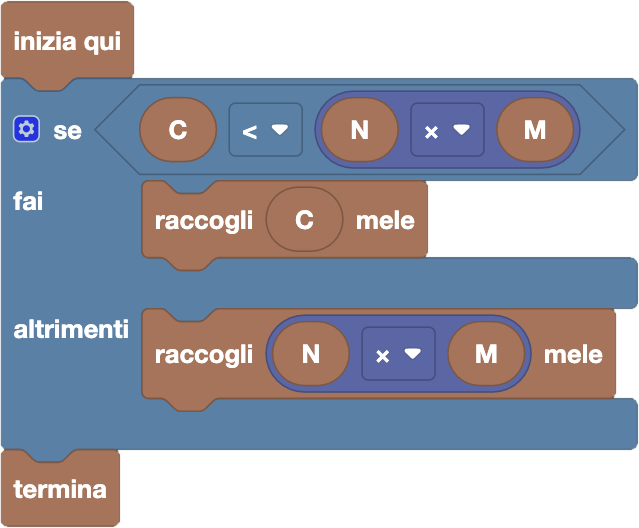

import { toolboxEn as toolbox } from "./toolbox.en";
import initialBlocks from "./initial-blocks.json";
import customBlocks from "./s1.en.blocks";
import testcases from "./testcases.py";
import { VisualizerEn as Visualizer } from "./visualizer";
import { Hint } from "~/utils/hint";

Tip-Tap has some apple trees in his garden, each with the same number of apples.
Tip-Tap wants to pick as many apples as possible, but only has one basket large enough for a certain number of apples:
if he picked more than the basket can hold, they would spill everywhere!
You have these blocks:

- `N`: the number of apple trees.
- `M`: the number of apples in each tree.
- `C`: the maximum number of apples the basket can hold.
- `pick` $x$ `apples`: pick $x$ apples from the trees, placing them in the basket.
- `finish`: bring the basket home.

Help Tip-Tap pick as many apples as possible without breaking his basket!

To solve this problem, you will need to use a new category of blocks: _“Math”_, which allows simple arithmetic operations on numerical value blocks (rounded).
In addition, you will also need a new truth block (hexagonal) at the beginning of the _“Logic”_ category, used to compare two numerical value blocks.

<Hint label="hint 1">
  There are two cases you need to consider: what are they?
</Hint>

<Hint label="hint 2">
  How can you count the total number of apples using a math formula?
  Remember that with the _“Math”_ blocks you can include formulas in your programs.
</Hint>

<Hint label="hint 3">
  Think about how to use logic blocks to impose the desired conditions!
</Hint>

<Blockly
  toolbox={toolbox}
  customBlocks={customBlocks}
  initialBlocks={initialBlocks}
  testcases={testcases}
  visualizer={Visualizer}
/>

> One possible correct program is:
>
> 
>
> There are two cases: either the basket is not big enough to hold all apples, or it is.
> In the first case, we pick apples until the basket is full ($C$).
> In the second case, we pick all apples from the trees ($N 	imes M$).

Before moving to the next question, make sure you have solved **all levels** of this one!
