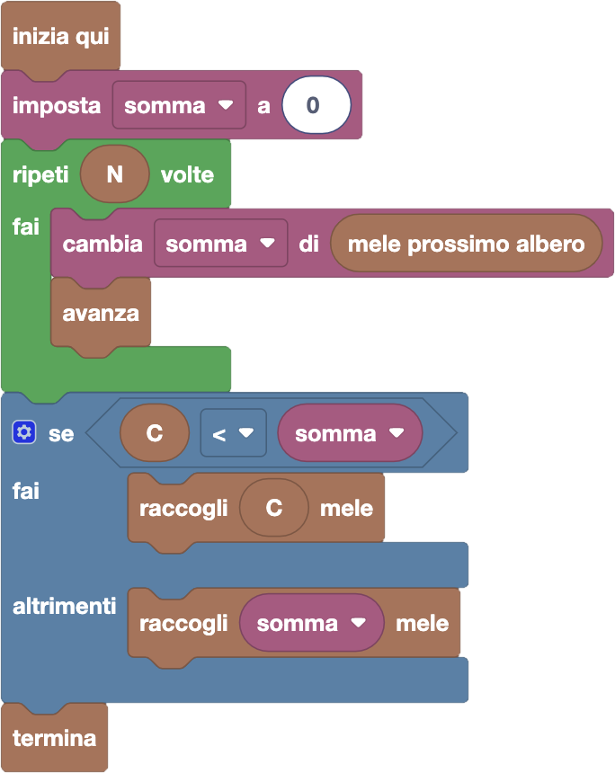

import { toolboxEn as toolbox } from "./toolbox.en";
import initialBlocks from "./initial-blocks.json";
import customBlocks from "./s2.en.blocks";
import testcases from "./testcases.py";
import { VisualizerEn as Visualizer } from "./visualizer";
import { Hint } from "~/utils/hint";

After the last harvest, more apples have ripened! This time, however, each tree has a different number of apples.
You have these blocks:

- `N`: the number of apple trees.
- `apples next tree`: the number of apples in the tree in front of Tip-Tap **(new!)**.
- `advance`: Tip-Tap advances past the tree currently in front of him **(new!)**.
- `C`: the maximum number of apples the basket can hold.
- `pick` $x$ `apples`: pick $x$ apples from the trees, placing them in the basket.
- `finish`: bring the basket home.

Help Tip-Tap pick as many apples as possible without breaking his basket!

To solve this problem, you will need to use a new category of blocks: _“Variables”_.
Variables are containers where you can store numbers, to reuse and modify them later. When you start a new program, there are no variables: you add them when needed by clicking on _“create variable”_ in the _“Variables”_ section.

Once a variable is created, several blocks appear in the _“Variables”_ section:
- the instruction block **set _variable_ to _value_**;
- the instruction block **change _variable_ by _value_**;
- a numeric block with the name of the variable, to read its content.

Remember to give your variable an initial value before using it!

<Hint>
  First count the total apples across all trees using a variable in a repeat N loop. Then compare the total with $C$ and pick the minimum of the two!
</Hint>

<Blockly
  toolbox={toolbox}
  customBlocks={customBlocks}
  initialBlocks={initialBlocks}
  testcases={testcases}
  visualizer={Visualizer}
/>

> One possible correct program is:
>
> 
>
> In this program, Tip-Tap uses a variable `total` starting at zero.
> Repeating $N$ times, he adds the apples of the next tree to `total` and advances.
> Finally, if `total` is less than or equal to $C$, he picks `total` apples; otherwise he picks $C$ apples.
