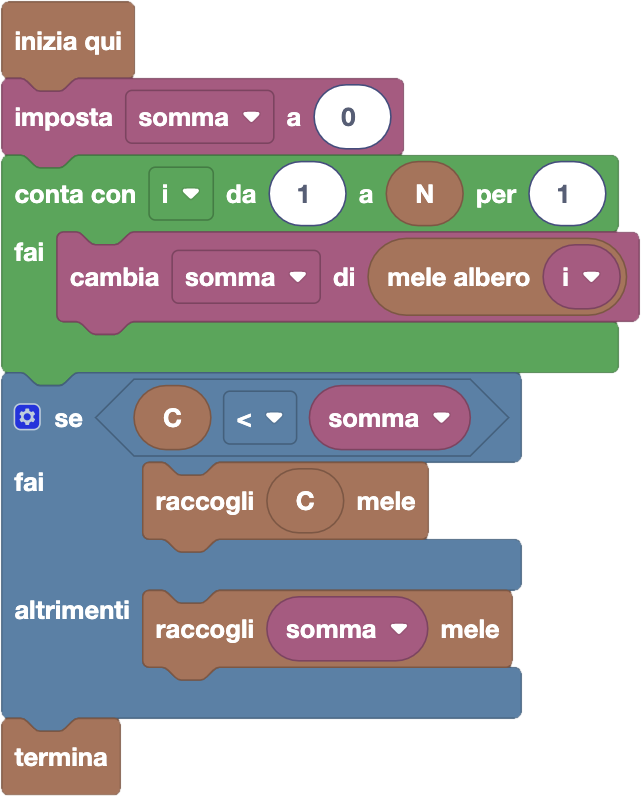

import { toolboxEn as toolbox } from "./toolbox.en";
import initialBlocks from "./initial-blocks.json";
import customBlocks from "./s3.en.blocks";
import testcases from "./testcases.py";
import { VisualizerEn as Visualizer } from "./visualizer";
import { Hint } from "~/utils/hint";

Tip-Tap has bought a telescope and can now count the apples on any tree directly from home!
You have these blocks:

- `N`: the number of apple trees.
- `apples tree` $x$: the number of apples in the $x$-th tree **(new!)**.
- `C`: the maximum number of apples the basket can hold.
- `pick` $x$ `apples`: pick $x$ apples from the trees, placing them in the basket.
- `finish`: bring the basket home.

Help Tip-Tap again pick as many apples as possible without breaking his basket!

To solve this problem, you will need to use a new block: the **count with loop**, located in the _“Loops”_ category. When you add this loop to your program, a new variable is automatically created with the conventional name $i$. The loop asks you to specify:

- a range of values “from/to”;
- and an increment step “by”.

<Hint>
  You can reuse the same structure as the previous question, replacing the repeat N loop with a count with loop from 1 to N!
</Hint>

<Blockly
  toolbox={toolbox}
  customBlocks={customBlocks}
  initialBlocks={initialBlocks}
  testcases={testcases}
  visualizer={Visualizer}
/>

> One possible correct program is:
>
> 
>
> As in the previous question, Tip-Tap first counts the total apples, this time using a count loop iterating $i$ from $1$ to $N$, adding `apples tree i` to his sum variable. Finally, he picks the minimum between the total apples and $C$.
