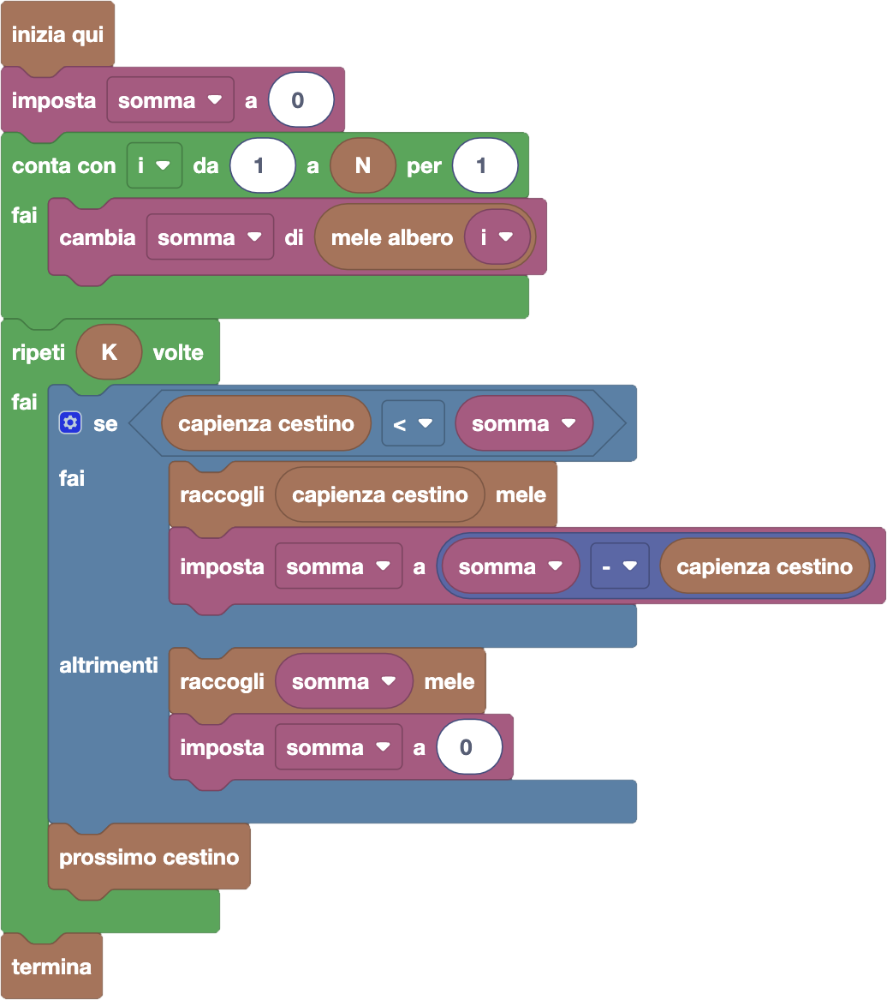

import { toolboxEn as toolbox } from "./toolbox.en";
import initialBlocks from "./initial-blocks.json";
import customBlocks from "./s4.en.blocks";
import testcases from "./testcases.py";
import { VisualizerEn as Visualizer } from "./visualizer";
import { Hint } from "~/utils/hint";

It’s time for one last apple harvest for Tip-Tap!
Each tree again has a different number of apples, and Tip-Tap can still count them from afar.
This time, however, Tip-Tap has several baskets, each with its own maximum capacity.
You have these blocks:

- `N`: the number of apple trees.
- `apples tree` $x$: the number of apples in the $x$-th tree.
- `K`: the number of baskets Tip-Tap has **(new!)**.
- `basket capacity`: the maximum capacity of the current basket **(new!)**.
- `next basket`: move to the next basket **(new!)**.
- `pick` $x$ `apples`: pick $x$ apples from the trees, placing them in the current basket.
- `finish`: finish the harvest.

Help Tip-Tap again pick as many apples as possible without breaking any basket!

<Hint label="hint 1">
  Try adapting the solution from the previous question. Where do you need to modify the program to handle $K$ baskets instead of just one?
</Hint>

<Hint label="hint 2">
  Each time you consider a basket, decide how many apples to put into it. How should you update the total apples remaining on the trees after each basket?
</Hint>

<Hint label="hint 3">
  Remember that you can update variables inside a loop, using math formulas or conditional blocks as needed!
</Hint>

<Blockly
  toolbox={toolbox}
  customBlocks={customBlocks}
  initialBlocks={initialBlocks}
  testcases={testcases}
  visualizer={Visualizer}
/>

> One possible correct program is:
>
> 
>
> As in the previous question, Tip-Tap first sums the total apples with a count loop into a variable `sum`.
> Then, repeating $K$ times (once per basket), he checks if `sum` is less than or equal to the current basket capacity. If so, he picks `sum` apples and subtracts `sum` from `sum` (leaving 0). Otherwise, he picks `basket capacity` apples and subtracts `basket capacity` from `sum`. Before repeating, he switches to the next basket.
