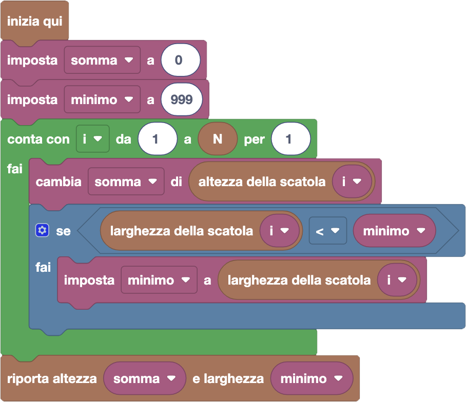

import { toolboxEn as toolbox } from "./toolbox.en";
import initialBlocks from "./initial-blocks.json";
import customBlocks from "./s1.en.blocks";
import testcases from "./testcases.py";
import { VisualizerEn as Visualizer } from "./visualizer";
import { Hint } from "~/utils/hint";

Bunny and his friends are looking for Easter eggs hidden around Fibonacci Farm!
Bunny is convinced there are eggs hidden on the roofs as well, so he decided to build a tower to reach higher.
To do so, he stacked $N$ rectangular boxes of various sizes.
You have these blocks:

- `N`: the number of stacked boxes.
- `height of box` $i$: the height of the $i$-th box.
- `width of box` $i$: the width of the $i$-th box.
- `report height` $h$ `and width` $w$: finish the program reporting $h$ as total tower height, and $w$ as the **minimum** width of the tower.

Help Bunny calculate the dimensions of his tower!
**Note:** Bunny wants to know if the tower can support his weight, so for width only the **narrowest** point of the tower matters.

<Hint label="hint 1">
  In this problem there are no choices to make, so no greedy strategy is needed.
  Instead we can use concepts from lesson 4: which ones are useful for calculating sum and minimum?
</Hint>

<Hint label="hint 2">
  Calculating height is very similar to problem 3 of lesson 4.
  Calculating minimum width is also similar, but requires a conditional check.
</Hint>

<Blockly
  toolbox={toolbox}
  customBlocks={customBlocks}
  initialBlocks={initialBlocks}
  testcases={testcases}
  visualizer={Visualizer}
/>

> One possible correct program is:
>
> 
>
> In this program we create a variable `sum`, starting at zero, to accumulate total height.
> We also create a variable `min_w`, starting at a value greater than any box dimension (e.g. 999), to track the minimum width.
>
> With a count loop iterating over all boxes from $1$ to $N$, we add each box's height to `sum`.
> Furthermore, if the current box's width is less than `min_w`, we update `min_w` to that width.
> Finally, we report `sum` and `min_w`.

Before moving to the next question, make sure you have solved **all levels** of this one!
