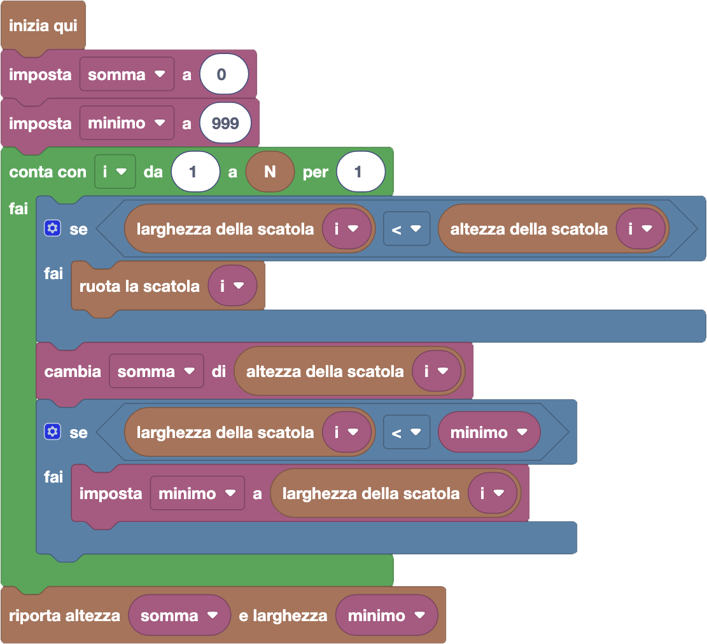

import { toolboxEn as toolbox } from "./toolbox.en";
import initialBlocks from "./initial-blocks.json";
import customBlocks from "./s2.en.blocks";
import testcases from "./testcases.py";
import { VisualizerEn as Visualizer } from "./visualizer";
import { Hint } from "~/utils/hint";

After measuring his tower, Bunny worries that it is not wide enough to support his weight!
He wants to make the tower **as wide as possible** by rotating some of the boxes that compose it.
You have these blocks:

- `N`: the number of stacked boxes.
- `height of box` $i$: the height of the $i$-th box.
- `width of box` $i$: the width of the $i$-th box.
- `rotate box` $i$: rotate the $i$-th box by 90 degrees, swapping its height and width **(new!)**.
- `report height` $h$ `and width` $w$: finish reporting total height $h$ and minimum width $w$.

Help Bunny build the widest tower!

Note that this time Bunny has a sequence of choices: for each box, whether to rotate it or not.
In this question, you can achieve the best result by following a _greedy algorithm_: each choice is made locally without worrying about future choices, because the rotation of one box doesn't affect the others.

<Hint label="hint 1">
  What orientation makes each box contribute the most to the tower's width?
</Hint>

<Hint label="hint 2">
  For each box, check whether its height is greater than its width. If so, rotate it!
</Hint>

<Blockly
  toolbox={toolbox}
  customBlocks={customBlocks}
  initialBlocks={initialBlocks}
  testcases={testcases}
  visualizer={Visualizer}
/>

> One possible correct program is:
>
> 
>
> In this program, for each box from $1$ to $N$, we rotate the box if its height is greater than its width. Then we compute the height sum and minimum width just like in the previous problem.
