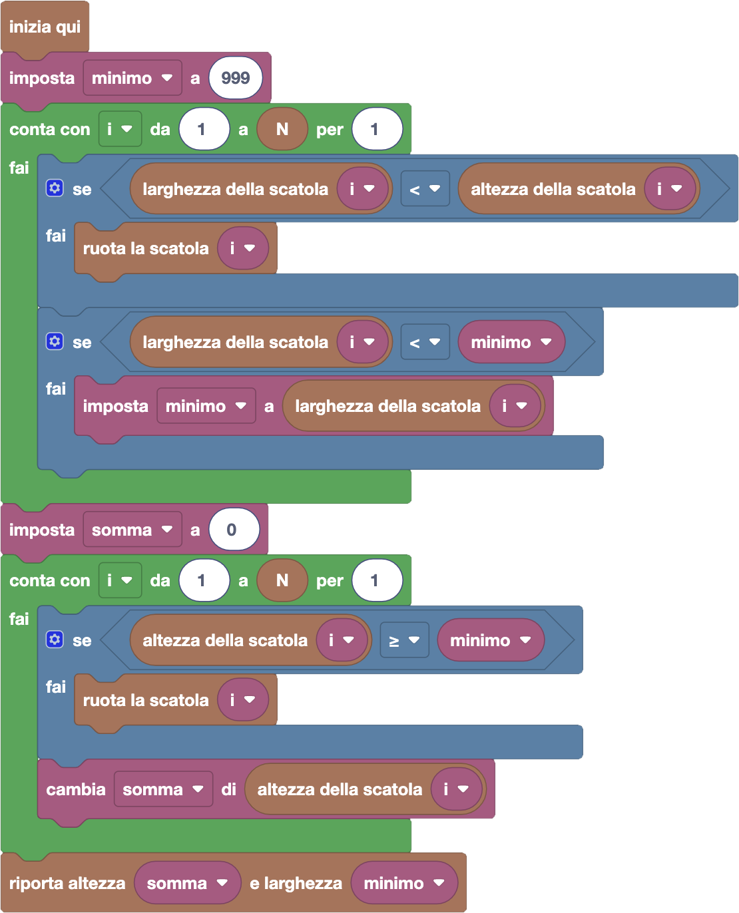

import { toolboxEn as toolbox } from "./toolbox.en";
import initialBlocks from "./initial-blocks.json";
import customBlocks from "./s3.en.blocks";
import testcases from "./testcases.py";
import { VisualizerEn as Visualizer } from "./visualizer";
import { Hint } from "~/utils/hint";

Now that the tower is as wide as possible, Bunny looks up at the roofs and realizes that he cannot reach any of them!
He needs to make the tower **taller**, but without making it dangerously narrow: it must maintain a minimum width of at least $K$.
You have these blocks:

- `N`: the number of stacked boxes.
- `K`: the minimum width required for the tower **(new!)**.
- `height of box` $i$: the height of the $i$-th box.
- `width of box` $i$: the width of the $i$-th box.
- `rotate box` $i$: rotate the $i$-th box by 90 degrees.
- `report height` $h$ `and width` $w$: finish reporting total height $h$ and minimum width $w$.

Help Bunny make the tower as tall as possible while keeping its minimum width at least $K$!

<Hint label="hint 1">
  When does rotating a box increase the tower's height?
  And when is rotating it safe without violating the minimum width $K$?
</Hint>

<Hint label="hint 2">
  To maximize height, we want the larger dimension of each box to be vertical (height), as long as its horizontal dimension (width) remains $\ge K$.
</Hint>

<Blockly
  toolbox={toolbox}
  customBlocks={customBlocks}
  initialBlocks={initialBlocks}
  testcases={testcases}
  visualizer={Visualizer}
/>

> One possible correct program is:
>
> 
>
> For each box from $1$ to $N$, if rotating the box makes its height taller and its width is still at least $K$, we rotate it. Then we compute the total height and minimum width and report them.
