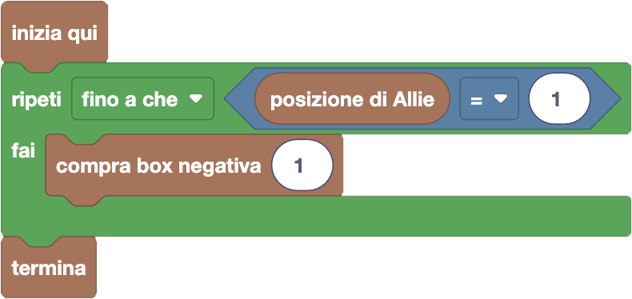

import { toolboxEn as toolbox } from "./toolbox.en";
import initialBlocks from "./initial-blocks.json";
import customBlocks from "./s4.en.blocks";
import testcases from "./testcases.py";
import { VisualizerEn as Visualizer } from "./visualizer";
import { Hint } from "~/utils/hint";

Allie Moss decided to start playing FarmCraft. The game seems quite fun, but there is one problem: Allie is still far behind in the global leaderboard!
She could practice to raise her score, but Allie has a better plan.

The FarmCraft leaderboard contains $N$ players, with the $i$-th player having score $P_i$.
In the game store, Allie saw that one can buy $N$ different _negative boxes_, numbered $1$ to $N$, each costing $C$ carrots. Buying the $i$-th box lowers by $1$ point the score of whoever is currently in $i$-th position.
Each box can be bought any number of times. Since Allie is wealthy, she decided to lower everyone else's score below hers to become first in the leaderboard!
You have these blocks:

- `N`: the number of FarmCraft players.
- `Allie's position`: Allie's current position in the leaderboard.
- `player's score` $i$: the score $P_i$ of the player currently in $i$-th position.
- `cost of negative boxes`: cost $C$ in carrots of the negative boxes.
- `buy negative box` $i$: buy negative box $i$ and lower by $1$ the score of whoever is currently $i$-th.
- `finish`: enjoy the well-deserved victory.

Help Allie reach first place in the leaderboard while spending as few carrots as possible!

<Hint label="hint 1">
  Whose score should you lower to make Allie climb the leaderboard fastest?
</Hint>

<Hint label="hint 2">
  To overtake a player, you must reduce their score below Allie's. Which player ahead of Allie requires the fewest boxes to overtake?
</Hint>

<Blockly
  toolbox={toolbox}
  customBlocks={customBlocks}
  initialBlocks={initialBlocks}
  testcases={testcases}
  visualizer={Visualizer}
/>

> One possible correct program is:
>
> 
>
> In this program, Allie repeatedly buys the negative box for position $1$ (lowering the top player's score) until Allie's position becomes $1$.
