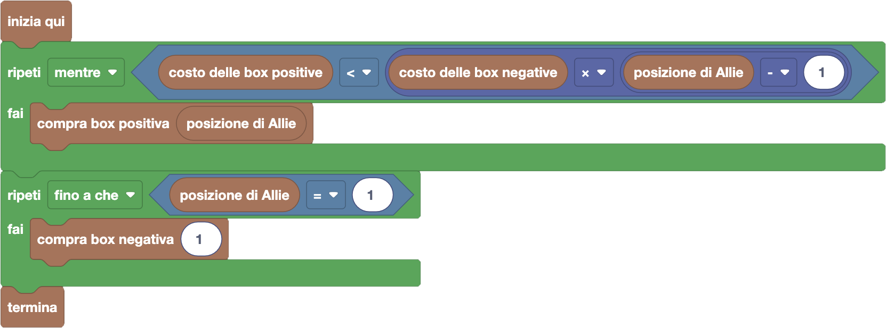

import { toolboxEn as toolbox } from "./toolbox.en";
import initialBlocks from "./initial-blocks.json";
import customBlocks from "./s5.en.blocks";
import testcases from "./testcases.py";
import { VisualizerEn as Visualizer } from "./visualizer";
import { Hint } from "~/utils/hint";

Shortly after buying some negative boxes, Allie noticed that FarmCraft introduced a new type of box: **positive boxes**!
Buying the $i$-th positive box, costing $K$ carrots, **raises** by $1$ point the score of whoever is currently in $i$-th position.
As before, each box can be bought any number of times. You have these blocks:

- `N`: the number of FarmCraft players.
- `Allie's position`: Allie's current position in the leaderboard.
- `player's score` $i$: score $P_i$ of the player currently in $i$-th position.
- `cost of positive boxes`: cost $K$ in carrots of positive boxes **(new!)**.
- `cost of negative boxes`: cost $C$ in carrots of negative boxes.
- `buy positive box` $i$: pay for positive box $i$ and raise player $i$'s score by $1$ **(new!)**.
- `buy negative box` $i$: pay for negative box $i$ and lower player $i$'s score by $1$.
- `finish`: enjoy the well-deserved victory.

Help Allie reach first place in the leaderboard while spending as little as possible!

<Hint label="hint 1">
  This time you have choices to make greedily: is a positive box better or a negative box?
</Hint>

<Hint label="hint 2">
  If you buy one positive box for Allie, how many negative boxes does that save you from having to buy?
</Hint>

<Hint label="hint 3">
  It is best to buy all boxes of one type first (which one?) and then all boxes of the other type, using two “repeat while/until” loops.
</Hint>

<Blockly
  toolbox={toolbox}
  customBlocks={customBlocks}
  initialBlocks={initialBlocks}
  testcases={testcases}
  visualizer={Visualizer}
/>

> One possible correct program is:
>
> 
>
> Buying a positive box for Allie is equivalent to buying a negative box for all players above her.
> The positive box costs $K$, while negative boxes cost $C \times (i - 1)$ where $i$ is Allie's current position.
> Therefore, a positive box is beneficial as long as $K < C \times (i - 1)$. As Allie climbs the leaderboard, $i - 1$ decreases, so positive boxes are only advantageous initially.
> Allie first buys positive boxes for her position while $K < C \times (i - 1)$, then switches to buying negative boxes for position $1$ until she becomes first.
