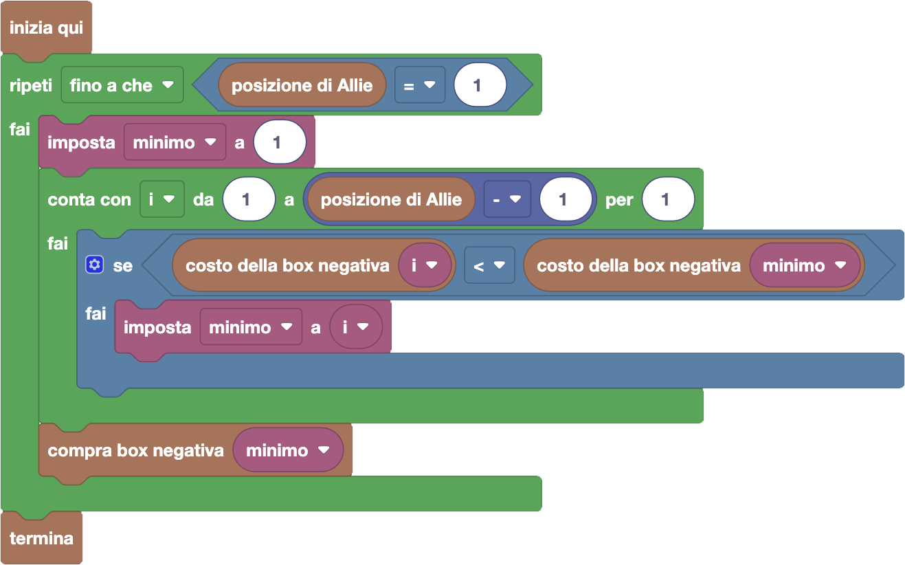

import { toolboxEn as toolbox } from "./toolbox.en";
import initialBlocks from "./initial-blocks.json";
import customBlocks from "./s6.en.blocks";
import testcases from "./testcases.py";
import { VisualizerEn as Visualizer } from "./visualizer";
import { Hint } from "~/utils/hint";

Before Allie can buy all the boxes she needs to become first, the FarmCraft developers changed the rules again!
They removed positive boxes, and made it so that negative boxes **each have a different cost!**

Specifically, the $i$-th negative box, which lowers the score of whoever is currently in $i$-th position, costs $C_i$ carrots.
As always, each box can be bought any number of times. You have these blocks:

- `N`: the number of FarmCraft players.
- `Allie's position`: Allie's current position in the leaderboard.
- `player's score` $i$: score $P_i$ of the player currently in $i$-th position.
- `cost of negative box` $i$: cost $C_i$ in carrots of negative box $i$ **(new!)**.
- `buy negative box` $i$: pay for negative box $i$ and lower player $i$'s score by $1$.
- `finish`: enjoy the well-deserved victory.

Help Allie finally reach first place once and for all, while spending as few carrots as possible!

<Hint label="hint 1">
  Which negative box is best to buy? What is the condition where you can stop?
</Hint>

<Hint label="hint 2">
  To find the best box to buy, the procedure has parts in common with the solution to the first question of this lesson.
</Hint>

<Blockly
  toolbox={toolbox}
  customBlocks={customBlocks}
  initialBlocks={initialBlocks}
  testcases={testcases}
  visualizer={Visualizer}
/>

> One possible correct program is:
>
> 
>
> According to this program, Allie keeps buying boxes until she is first in the leaderboard.
> Each time, among the boxes for players above her, she always chooses the one with the **minimum cost** (greedy choice).
>
> To find the box with minimum cost, we use a `min_idx` variable. We inspect all boxes $i$ from $1$ up to the position just before Allie using a count loop: if box $i$ costs less than the box saved in `min_idx`, we set `min_idx` to $i$.
