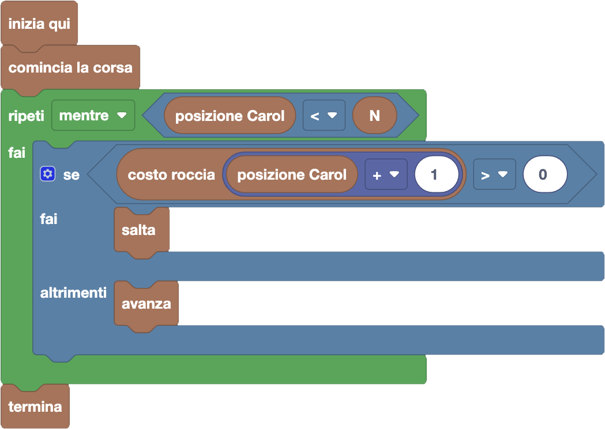

import { toolboxEn as toolbox } from "./toolbox.en";
import initialBlocks from "./initial-blocks.json";
import customBlocks from "./s1.en.blocks";
import testcases from "./testcases.py";
import { VisualizerEn as Visualizer } from "./visualizer";
import { Hint } from "~/utils/hint";

Carol, known for her passion for obstacle racing, is entering a new kind of competition:
the **toll race**! It works similarly to an obstacle race, except that instead of obstacles (where one can never land), there are brown rocks that require a toll.
Carol can land or advance on toll rocks, but doing so incurs a penalty of several carrots at the end of the race! To avoid paying for a brown rock, the only way is to jump over it.

The course consists of $N$ rocks, numbered $1$ to $N$, with the $i$-th rock having a cost $P_i$.
Carol begins right before the first rock and must reach or pass the final flag (on the last rock).
In this first race, the organizers ensured that **there are never two toll rocks in a row**. You have these blocks to inspect the course:

- `N`: the number of rocks on the course.
- `Carol's position`: Carol's current position.
- `rock cost` $i$: the cost $P_i$ in carrots to land or advance on the $i$-th rock (zero for free rocks).

Additionally, you have these blocks to run the race:

- `start race`: start the race from the starting position.
- `advance`: advance to the next rock.
- `jump`: jump over the next rock, landing on the one after it.
- `finish`: finish the race and pay any penalties.

Help Carol complete the course paying as few carrots as possible!

<Hint>
  When you start the race, at each point of the course you must choose between advancing and jumping.
  As in the previous lesson, you can choose what to do greedily!
</Hint>

<Blockly
  toolbox={toolbox}
  customBlocks={customBlocks}
  initialBlocks={initialBlocks}
  testcases={testcases}
  visualizer={Visualizer}
/>

> One possible correct program is:
>
> 
>
> According to this program, Carol starts the race immediately from the starting position.
> Then, until she reaches the last rock (at position $N$), she proceeds by jumping or advancing.
> If the rock ahead of Carol is free, she advances; if it is a toll rock, she jumps over it.
> Since no two toll rocks are consecutive, Carol reaches the end of the course without paying any carrots!
