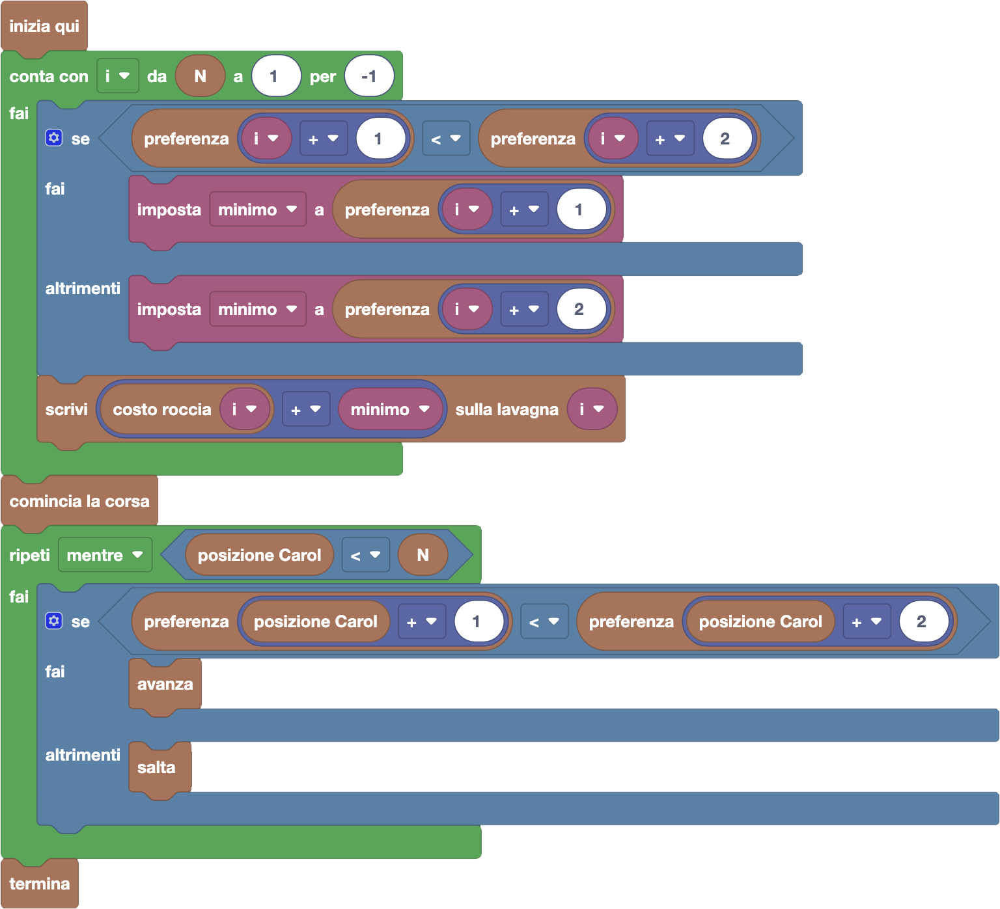

import { toolboxEn as toolbox } from "./toolbox.en";
import initialBlocks from "./initial-blocks.json";
import customBlocks from "./s2.en.blocks";
import testcases from "./testcases.py";
import { VisualizerEn as Visualizer } from "./visualizer";
import { Hint } from "~/utils/hint";

Carol wants to enter another toll race. Since the organizers made little profit from the first race, they decided that now **every single rock will be a toll rock**!
However, they placed a chalkboard at each position, where participants can write down a **numerical preference** for each position **before starting the race**.

You have the same blocks as before to inspect the situation:

- `N`: the number of rocks on the course.
- `Carol's position`: Carol's current position.
- `rock cost` $i$: the cost $P_i$ in carrots to land on the $i$-th rock.

In addition, you have two new blocks to read and write on the chalkboards:

- `write` $x$ `on chalkboard` $i$: write preference $x$ on the $i$-th chalkboard before starting the race **(new!)**.
- `preference` $i$: the number written on the $i$-th chalkboard, <u>or zero if chalkboard $i$ does not exist</u> **(new!)**.

You also have the same blocks as before to run the race:

- `start race`: start the race from the starting position.
- `advance`: advance to the next rock.
- `jump`: jump over the next rock, landing on the one after it.
- `finish`: finish the race and pay penalties.

Help Carol complete the course paying as few carrots as possible!

<Hint label="hint 1">
  What does the number on chalkboard $i$ represent? It could represent the minimum cost to reach the end starting from rock $i$!
</Hint>

<Hint label="hint 2">
  To calculate the values on the chalkboards, should you iterate forwards or backwards from rock $N$ down to $1$?
</Hint>

<Blockly
  toolbox={toolbox}
  customBlocks={customBlocks}
  initialBlocks={initialBlocks}
  testcases={testcases}
  visualizer={Visualizer}
/>

> One possible correct program is:
>
> 
>
> In this program, we first iterate backwards from rock $N$ down to $1$.
> For each rock $i$, the minimum cost from rock $i$ to the end is $P_i + \min(\text{preference}(i+1), \text{preference}(i+2))$.
> Once the chalkboards are filled, Carol starts the race: from each rock, she compares `preference(pos + 1)` and `preference(pos + 2)`, choosing to advance if advancing leads to a smaller or equal remaining cost, and jumping otherwise.
