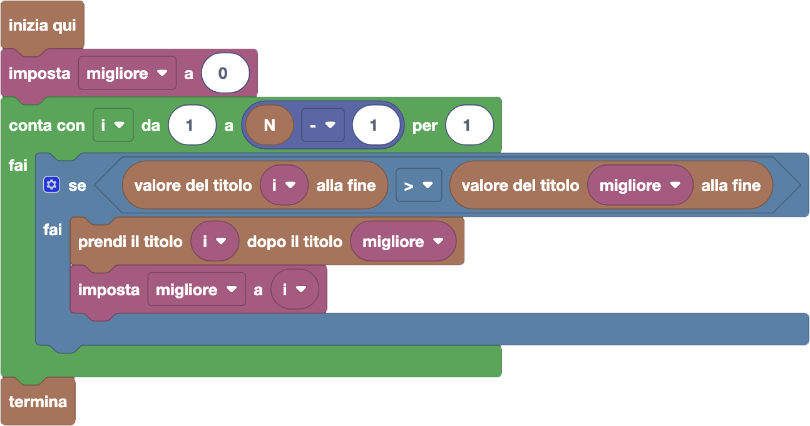

import { toolboxEn as toolbox } from "./toolbox.en";
import initialBlocks from "./initial-blocks.json";
import customBlocks from "./s3.en.blocks";
import testcases from "./testcases.py";
import { VisualizerEn as Visualizer } from "./visualizer";
import { Hint } from "~/utils/hint";

For his birthday, Tip-Tap was gifted an investment bond in **Carrot**!
By law, when purchased, all investment bonds have a fixed value of $10$ carrots.
Furthermore, each bond has its own income rate $G$: its value increases by $G$ carrots each day, so after $k$ days it is worth $10 + k \times G$.
Specifically, the Carrot bond has an income rate of 1 carrot per day.

Our friend wants to venture into finance. Each day, a single bond is available: on day $i$, a bond with income rate $G_i$.
Tip-Tap can only ever own one bond at a time: if he already owns a bond, he can exchange it for the current day's bond, but **without receiving any accrued income**.
He only collects accrued income by selling the bond at the end of $N$ days.

Tip-Tap discovered which bonds will be offered over the next $N-1$ days.
Use this information to maximize total profit at the end!

You have these blocks to inspect the market:

- `N`: the number of days until the bond is redeemed.
- `bond earnings` $i$: the daily income rate $G_i$ that the $i$-th bond will have each following day.
- `bond value` $i$ `at the end`: the final value of the bond proposed on day $i$, increased by $G_i$ for each day up to day $N$ ($10 + (N-i) \cdot G_i$).

Additionally, you have these blocks to set up a financial plan:

- `take bond` $k$ `after bond` $i$: plan to take bond $k$ as the next bond after $i$ (if you hold bond $i$).
- `do not take further bonds after` $i$: plan to keep bond $i$ until the end of the $N$ days.
- `finish`: execute the plan you configured with blocks until the end of the $N$ days.

<Hint>
  Each day, decide whether it is better to keep the bond you hold or exchange it for the day's bond.
  You can make this choice greedily!
</Hint>

<Blockly
  toolbox={toolbox}
  customBlocks={customBlocks}
  initialBlocks={initialBlocks}
  testcases={testcases}
  visualizer={Visualizer}
/>

> One possible correct program is:
>
> 
>
> We scan the bonds from first to last looking for the one that gives the highest final value.
> We create a variable `best` starting at 0 (the Carrot bond).
> While scanning, if the current bond gives a higher final value, we set our plan to exchange `best` for the current bond, and update `best` to the current bond.
