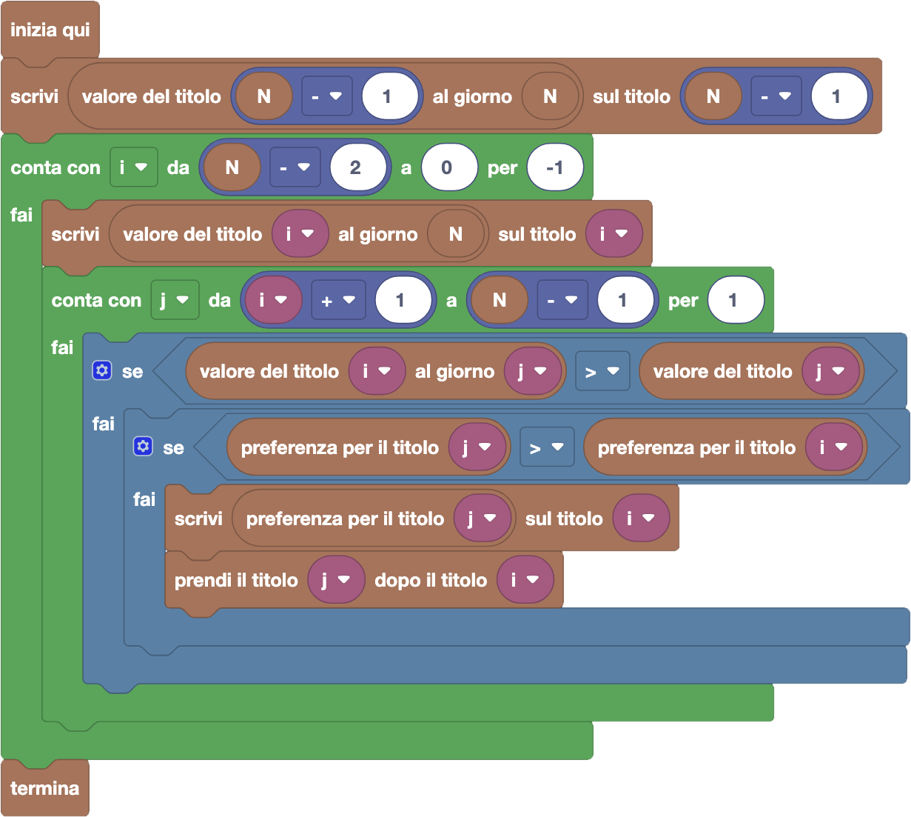

import { toolboxEn as toolbox } from "./toolbox.en";
import initialBlocks from "./initial-blocks.json";
import customBlocks from "./s4.en.blocks";
import testcases from "./testcases.py";
import { VisualizerEn as Visualizer } from "./visualizer";
import { Hint } from "~/utils/hint";

After the first investment season, the regulations were relaxed!
Bonds no longer all have the initial value of 10 carrots: each bond on day $i$ has its own initial value $T_i$.
Tip-Tap starts again with a Carrot bond, which now begins with value $T_0$ and has income rate $G_0$, so after $k$ days it is worth $T_0 + k \cdot G_0$.

Trading works as before with one difference: Tip-Tap can only exchange his current bond for the day's bond if his current bond is worth strictly more on that day than the proposed bond.

You have these blocks to inspect the market:

- `N`: the number of days.
- `bond value` $i$: the initial value $T_i$ of the bond proposed on day $i$ **(new!)**.
- `bond earnings` $i$: the daily income $G_i$ of the $i$-th bond.
- `bond value` $i$ `on day` $d$: the value of bond $i$ on day $d$, namely $T_i + (d - i) \cdot G_i$ **(new!)**.

In addition, you have blocks to record notes:

- `write preference` $x$ `for bond` $i$: write a number $x$ of your choice on bond $i$ **(new!)**.
- `read preference for bond` $i$: read the number written on bond $i$ **(new!)**.

Finally, you have the same blocks as before to establish your trading plan:

- `take bond` $k$ `after bond` $i$: plan to take bond $k$ after bond $i$.
- `do not take further bonds after` $i$: plan to hold bond $i$ until day $N$.
- `finish`: execute your plan until day $N$.

<Hint label="hint 1">
  What should the preference value represent? It could represent the maximum value you can achieve at day $N$ starting from holding bond $i$!
</Hint>

<Hint label="hint 2">
  To calculate the preference values, scan backwards from day $N-1$ down to $0$.
</Hint>

<Blockly
  toolbox={toolbox}
  customBlocks={customBlocks}
  initialBlocks={initialBlocks}
  testcases={testcases}
  visualizer={Visualizer}
/>

> One possible correct program is:
>
> 
>
> In this program, we scan bonds backwards from the last to the first.
> For the last bond, we record its final value.
> For each earlier bond $i$, we initially assume we hold it until day $N$. Then we check all future bonds $j > i$: if we are eligible to exchange bond $i$ for bond $j$ on day $j$, and doing so yields a higher total return according to `preference(j)`, we update the preference for $i$ and record to take bond $j$ after $i$.
