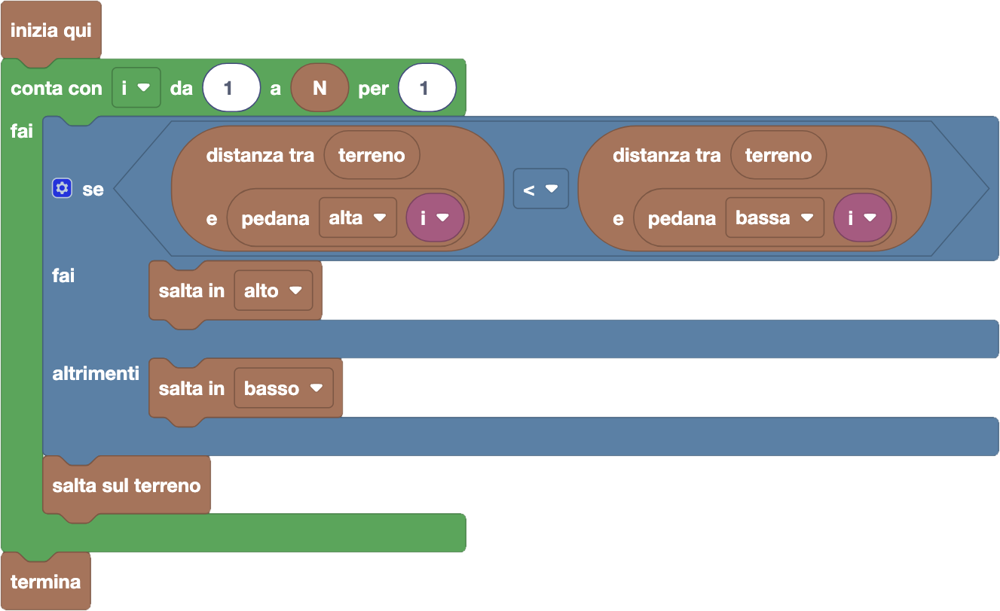

import { toolboxEn as toolbox } from "./toolbox.en";
import initialBlocks from "./initial-blocks.json";
import customBlocks from "./s5.en.blocks";
import testcases from "./testcases.py";
import { VisualizerEn as Visualizer } from "./visualizer";
import { Hint } from "~/utils/hint";

Bunny is playing Super Bunny Bros!
In this level, Bunny must cross $N$ pits. Across each pit there are two platforms at different heights: a high platform and a low platform.
Jumping between different heights takes time proportional to the height difference $|h_1 - h_2|$.
You have these blocks:

- `N`: the number $N$ of pits.
- `ground`: the height of all ground sections.
- `platform high/low` $i$: the height $A_i$ (or $B_i$) of the $i$-th high (or low) platform.
- `distance between x and y`: the distance $|x - y|$ between two numbers.
- `jump high/low`: jump to the next high/low platform.
- `jump to ground`: jump from a platform onto the next section of ground.
- `finish`: complete the level.

Help Bunny complete the level in the minimum possible time!

<Hint label="hint 1">
  For each step, jumping to the closest platform is not always best globally.
  Think about how to find the optimal path!
</Hint>

<Blockly
  toolbox={toolbox}
  customBlocks={customBlocks}
  initialBlocks={initialBlocks}
  testcases={testcases}
  visualizer={Visualizer}
/>

> One possible correct program is:
>
> 
>
> At each step, Bunny chooses between the high and low platform to minimize total traversal time.
