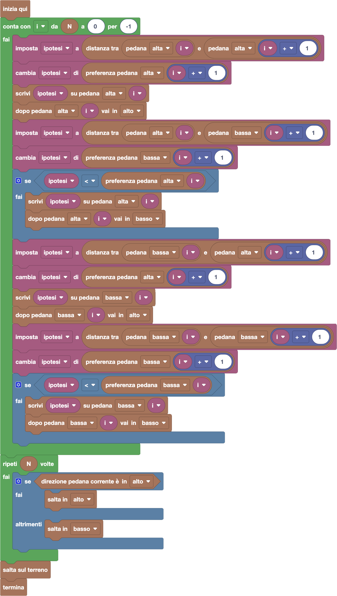

import { toolboxEn as toolbox } from "./toolbox.en";
import initialBlocks from "./initial-blocks.json";
import customBlocks from "./s6.en.blocks";
import testcases from "./testcases.py";
import { VisualizerEn as Visualizer } from "./visualizer";
import { Hint } from "~/utils/hint";

Bunny is facing an even harder level in Super Bunny Bros!
Across each pit there are again two platforms at different heights.
This time, you can write information directly on the platforms before jumping: both a numerical preference and a direction!
You have these blocks:

- `N`: the number $N$ of pits.
- `ground`: the height of all ground sections.
- `platform high/low` $i$: the height of the $i$-th platform.
- `distance between x and y`: the distance between two numbers.
- `platform preference high/low` $i$: the value written on platform $i$ **(new!)**.
- `write x on platform high/low` $i$: write value $x$ on platform $i$ **(new!)**.
- `current platform direction is up/down`: true if the direction chosen for the current platform is up/down **(new!)**.
- `after platform high/low` $i$ `go up/down`: set the direction to take after platform $i$ **(new!)**.
- `jump high/low`: jump to the next high/low platform.
- `jump to ground`: jump from a platform onto the next section of ground.
- `finish`: complete the level.

Help Bunny complete the level in the minimum time possible using dynamic programming!

<Hint label="hint 1">
  What should the preference value on each platform represent? The minimum time needed to complete the level starting from that platform!
</Hint>

<Hint label="hint 2">
  Iterate backwards from the last pit to the first to compute the preference and direction for each platform.
</Hint>

<Blockly
  toolbox={toolbox}
  customBlocks={customBlocks}
  initialBlocks={initialBlocks}
  testcases={testcases}
  visualizer={Visualizer}
/>

> One possible correct program is:
>
> 
>
> In this program, we iterate backwards over all platforms. For each platform, we test jumping up vs jumping down, compute the total time to the finish, write the minimum time as the preference, and record the best direction (up or down).
> Finally, Bunny traverses the level simply by following the recorded directions!
